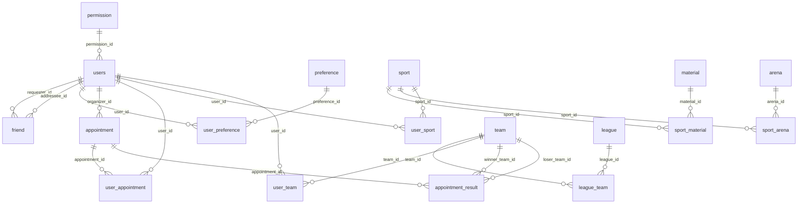

# Estrutura inicial do banco

Snapshot consolidado das migrations Laravel em `backend.old/database/migrations`.
As entities e migrations versionadas são os registros executáveis. Alterações posteriores
devem atualizar esta documentação quando mudarem conceitos, campos ou relacionamentos.

## Relacionamentos

## Convenções

- `bigint` e `numeric` são representados como strings no TypeScript para preservar precisão.
- Datas sem horário e horários são strings; timestamps são `Date`.
- `users.id` é um UUID atribuído pela aplicação, sem geração automática no banco.
- `appointment.location` é um Point PostGIS com o SRID original 0; não há conversão implícita para 4326.
- O índice `friend_unique_unordered_pair` é mantido por SQL explícito.
- As tabelas antigas de chat não fazem parte deste esquema de persistência.

## permission

Entity: `src/database/entities/permission.entity.ts`.

| Coluna | Tipo | Aceita nulo | Descrição |
|---|---|---|---|
| `id` | `bigint` | não | Chave primária autoincrementável. |
| `slug` | `varchar(255)` | não | Slug identificador da permissão. |
| `symbol` | `char(1)` | não | Símbolo representativo da permissão. |

## users

Entity: `src/database/entities/users.entity.ts`.

| Coluna | Tipo | Aceita nulo | Descrição |
|---|---|---|---|
| `id` | `uuid` | não | Identificador UUID do usuário. |
| `name` | `varchar(150)` | sim | Nome exibido do usuário. |
| `email` | `varchar(150)` | sim | Endereço de e-mail do usuário. |
| `username` | `varchar(45)` | sim | Nome de usuário para acesso. |
| `dt_birth` | `date` | sim | Data de nascimento do usuário. |
| `gender` | `char(1)` | sim | Gênero do usuário. |
| `image` | `varchar(150)` | sim | URL da foto de perfil do usuário. |
| `permission_id` | `bigint` | sim | Permissão opcional atribuída ao usuário. |
| `created_at` | `timestamp without time zone` | não | Data e hora de criação de user. |

## friend

Entity: `src/database/entities/friend.entity.ts`.

| Coluna | Tipo | Aceita nulo | Descrição |
|---|---|---|---|
| `id` | `bigint` | não | Identificador único do registro da tabela friend. |
| `requester_id` | `uuid` | não | Referência a usuário que enviou a solicitação relacionada à tabela friend. |
| `addressee_id` | `uuid` | não | Referência a usuário que recebeu a solicitação relacionada à tabela friend. |
| `status` | `varchar(255)` | não | Estado atual do registro de friend. |
| `created_at` | `timestamp without time zone` | sim | Data e hora de criação do registro. |
| `updated_at` | `timestamp without time zone` | sim | Data e hora da última atualização do registro. |

## preference

Entity: `src/database/entities/preference.entity.ts`.

| Coluna | Tipo | Aceita nulo | Descrição |
|---|---|---|---|
| `id` | `bigint` | não | Chave primária autoincrementável. |
| `desc_preference` | `varchar(45)` | não | Descrição da preferência. |
| `default_value` | `varchar(45)` | sim | Valor padrão para a preferência. |

## user_preference

Entity: `src/database/entities/user-preference.entity.ts`.

| Coluna | Tipo | Aceita nulo | Descrição |
|---|---|---|---|
| `user_id` | `uuid` | não | Referência ao ID do usuário. |
| `preference_id` | `bigint` | não | Referência ao ID da preferência. |
| `value` | `varchar(45)` | sim | Valor da preferência do usuário. |

## sport

Entity: `src/database/entities/sport.entity.ts`.

| Coluna | Tipo | Aceita nulo | Descrição |
|---|---|---|---|
| `id` | `bigint` | não | Chave primária autoincrementável. |
| `name` | `varchar(150)` | não | Nome do esporte. |
| `default_value_player_numbers` | `integer` | não | Número padrão de jogadores para o esporte. |

## material

Entity: `src/database/entities/material.entity.ts`.

| Coluna | Tipo | Aceita nulo | Descrição |
|---|---|---|---|
| `id` | `bigint` | não | Chave primária autoincrementável. |
| `description` | `varchar(250)` | não | Descrição do material relacionado a um esporte. |

## sport_material

Entity: `src/database/entities/sport-material.entity.ts`.

| Coluna | Tipo | Aceita nulo | Descrição |
|---|---|---|---|
| `id` | `bigint` | não | Chave primária autoincrementável. |
| `sport_id` | `bigint` | não | ID do esporte referido. |
| `material_id` | `bigint` | não | ID do material referido. |
| `related_to_local` | `boolean` | não | Material pertence ao local físico (true) ou o jogador providencia (false)? |

## arena

Entity: `src/database/entities/arena.entity.ts`.

| Coluna | Tipo | Aceita nulo | Descrição |
|---|---|---|---|
| `id` | `bigint` | não | Chave primária autoincrementável. |
| `address` | `varchar(150)` | não | Endereço da arena. |
| `lat` | `numeric(10, 7)` | não | Latitude para localização geográfica. |
| `longitude` | `numeric(11, 7)` | não | Longitude para localização geográfica. |
| `image` | `varchar(150)` | sim | Caminho da imagem da arena. |
| `is_league_only` | `boolean` | não | Indica se a arena é exclusiva para ligas. |

## sport_arena

Entity: `src/database/entities/sport-arena.entity.ts`.

| Coluna | Tipo | Aceita nulo | Descrição |
|---|---|---|---|
| `id` | `bigint` | não | Chave primária autoincrementável. |
| `sport_id` | `bigint` | não | Chave estrangeira referenciando a tabela "sport". |
| `arena_id` | `bigint` | não | Chave estrangeira referenciando a tabela "arena". |

## schedule

Entity: `src/database/entities/schedule.entity.ts`.

| Coluna | Tipo | Aceita nulo | Descrição |
|---|---|---|---|
| `id` | `bigint` | não | Identificador único para cada horário. |
| `horary` | `time without time zone` | não | Horário genérico. |

## league

Entity: `src/database/entities/league.entity.ts`.

| Coluna | Tipo | Aceita nulo | Descrição |
|---|---|---|---|
| `id` | `bigint` | não | ID da liga. |
| `name` | `varchar(45)` | não | Nome da liga. |
| `description` | `varchar(500)` | sim | Descrição da liga. |
| `league_number` | `bigint` | não | Número identificador da liga. |
| `image` | `varchar(150)` | sim | Imagem da liga. |

## appointment

Entity: `src/database/entities/appointment.entity.ts`.

| Coluna | Tipo | Aceita nulo | Descrição |
|---|---|---|---|
| `id` | `bigint` | não | Identificador único do registro da tabela appointment. |
| `organizer_id` | `uuid` | não | Referência a identificador do usuário organizador relacionada à tabela appointment. |
| `title` | `varchar(100)` | não | Título de appointment. |
| `description` | `text` | sim | Descrição de appointment. |
| `scheduled_at` | `timestamp without time zone` | não | Data e hora agendadas de appointment. |
| `status` | `varchar(255)` | não | Estado atual do registro de appointment. |
| `location` | `geometry(Point)` | sim | Localização geográfica de appointment. |
| `max_players` | `integer` | sim | Limite de participantes de appointment. |
| `created_at` | `timestamp without time zone` | sim | Data e hora de criação do registro. |
| `updated_at` | `timestamp without time zone` | sim | Data e hora da última atualização do registro. |
| `deleted_at` | `timestamp without time zone` | sim | Data e hora da exclusão lógica do registro. |

## user_appointment

Entity: `src/database/entities/user-appointment.entity.ts`.

| Coluna | Tipo | Aceita nulo | Descrição |
|---|---|---|---|
| `appointment_id` | `bigint` | não | ID do compromisso. |
| `user_id` | `uuid` | não | ID do usuário participante. |
| `holder` | `boolean` | não | Indica se o participante vai jogar como titular (true) ou reserva (false). |

## user_sport

Entity: `src/database/entities/user-sport.entity.ts`.

| Coluna | Tipo | Aceita nulo | Descrição |
|---|---|---|---|
| `user_id` | `uuid` | não | Usuário que declarou a preferência pelo esporte. |
| `sport_id` | `bigint` | não | Esporte preferido pelo usuário. |

## team

Entity: `src/database/entities/team.entity.ts`.

| Coluna | Tipo | Aceita nulo | Descrição |
|---|---|---|---|
| `id` | `bigint` | não | Identificador único para a equipe. |
| `name` | `varchar(45)` | não | Nome da equipe. |
| `description` | `text` | sim | Descrição da equipe. |
| `image` | `varchar(255)` | sim | URL da imagem da equipe. |
| `created_at` | `timestamp without time zone` | não | Data e hora de criação do registro. |

## league_team

Entity: `src/database/entities/league-team.entity.ts`.

| Coluna | Tipo | Aceita nulo | Descrição |
|---|---|---|---|
| `team_id` | `bigint` | não | Referência a identificador do time relacionada à tabela league_team. |
| `league_id` | `bigint` | não | Referência a league id relacionada à tabela league_team. |

## user_team

Entity: `src/database/entities/user-team.entity.ts`.

| Coluna | Tipo | Aceita nulo | Descrição |
|---|---|---|---|
| `id` | `bigint` | não | Identificador único do registro da tabela user_team. |
| `user_id` | `uuid` | não | Referência a identificador do usuário relacionada à tabela user_team. |
| `team_id` | `bigint` | não | Referência a identificador do time relacionada à tabela user_team. |
| `role` | `varchar(20)` | não | captain, member |
| `created_at` | `timestamp without time zone` | sim | Data e hora de criação do registro. |
| `updated_at` | `timestamp without time zone` | sim | Data e hora da última atualização do registro. |

## appointment_result

Entity: `src/database/entities/appointment-result.entity.ts`.

| Coluna | Tipo | Aceita nulo | Descrição |
|---|---|---|---|
| `id` | `bigint` | não | Identificador único do registro da tabela appointment_result. |
| `appointment_id` | `bigint` | não | Referência a identificador do agendamento relacionada à tabela appointment_result. |
| `winner_team_id` | `bigint` | sim | Referência a identificador do time vencedor relacionada à tabela appointment_result. |
| `loser_team_id` | `bigint` | sim | Referência a identificador do time perdedor relacionada à tabela appointment_result. |
| `winner_score` | `integer` | sim | Pontuação do vencedor de appointment_result. |
| `loser_score` | `integer` | sim | Pontuação do perdedor de appointment_result. |
| `notes` | `text` | sim | Observações de appointment_result. |
| `created_at` | `timestamp without time zone` | sim | Data e hora de criação do registro. |
| `updated_at` | `timestamp without time zone` | sim | Data e hora da última atualização do registro. |
| `winner_team_id` | `IS` | sim | Referência a identificador do time vencedor relacionada à tabela appointment_result. |
